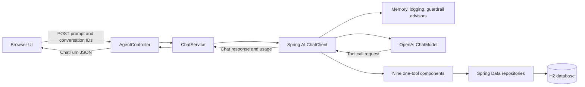

# Pennywise Expenses Agent

Pennywise is a small conversational finance application built with Spring Boot and Spring AI. A user can ask the agent to record transactions, review current or previous months, compare monthly results, and summarize income and available funds. The browser interface also shows the prompt, tool activity summary, model response, and token usage for the latest chat turn.

> **Learning project:** This application was created for self-learning and experimental purposes. It is not production-ready accounting software or financial advice. Review the technical gaps below before using it with sensitive or important financial data.

## Features

- Record transactions as `DEBIT` (money spent) or `CREDIT` (money received). If the direction is unclear, the agent asks before saving.
- Look up itemized `DEBIT` expenses and/or `CREDIT` income, optionally by category, for this month or previous months. If no month is specified, reports use the current calendar month.
- Itemized transaction results include record IDs, which can be used to update a transaction or request its deletion. Deletions require explicit user confirmation for the same record ID.
- Show monthly `DEBIT` spending totals and category breakdowns. Breakdown results include the selected month and year and count `DEBIT` entries only.
- Compare two or more supported months side by side when the prompt names each period. The agent queries each month separately, then can align monthly totals or category breakdowns in a Markdown table or chart.
- Set a default monthly salary. The agent asks for explicit confirmation before changing an existing salary.
- Request a monthly summary containing Total Spent, Total Credit, Monthly income, and Total available. Available is calculated as recorded credits plus configured monthly salary minus spending.
- Continue a conversation using an in-memory window of recent messages.
- Use a vanilla JavaScript, HTML, and CSS frontend with Bootstrap. Markdown and Mermaid output are rendered in chat; a collapsible panel shows the prompt, tool activity summary, response, and token counts.
- Store expenses and configuration in a local, file-backed H2 database.

## Architecture



The browser sends a prompt to `AgentController`. The controller combines the supplied `userId` and `sessionId` into a conversation ID, then delegates to `ChatService`. The service builds a Spring AI request with the prompt, conversation memory, tool context, and the application's tool components. Spring AI calls the configured model, which can request one or more tools. The tools use Spring Data repositories to read or update H2 records. The service returns the prompt, an observable tool activity summary, model response, and token usage as a `ChatTurn`.

The available tools are `AddExpenseTool`, `GetExpensesByCategoryTool`, `GetTransactionsTool`, `GetTotalSpendingTool`, `GetFinancialSummaryTool`, `GetSpendingBreakdownTool`, `SetDefaultMonthlyIncomeTool`, `UpdateExpenseTool`, and `DeleteExpenseTool`. Shared repository references and month-range logic are in `AbstractExpenseTool`; tool argument records are in `ExpenseToolInputs`.

### Month-specific reports and comparisons

Expense reporting tools accept a relative month offset. `0` is this calendar month, `1` is last month, `2` is two months ago, and larger values select earlier months. If the prompt does not name a period, the agent uses the current month. Transaction lookups can filter by `DEBIT`, `CREDIT`, or both, and can also filter by category. Spending totals and breakdowns include only `DEBIT` entries. Their output identifies the selected month and year.

For a comparison, name every period in the same prompt so the agent can make one query per period and combine the results. For example:

- “Compare my total spending this month and last month in a side-by-side table.”
- “Show a side-by-side category breakdown for this month and two months ago.”
- “Compare my income and expenses from last month with this month.”

The agent uses each tool result for its corresponding month, then labels and aligns the results in the response. For category comparisons, categories can be shown as rows and months as columns. The reporting interface supports relative periods; arbitrary date ranges and selecting any calendar month by its name are not currently available. A financial summary for a past month still uses the currently configured monthly salary, since salary settings are not versioned historically.

## Spring AI components

### `ChatClient` configuration

`ChatConfiguration` creates a reusable `ChatClient`, loads the system prompt as a Spring `Resource`, and adds default advisors:

```java
return ChatClient.builder(chatModel)
    .defaultSystem(systemPrompt, StandardCharsets.UTF_8)
    .defaultAdvisors(
        new SimpleLoggerAdvisor(Ordered.LOWEST_PRECEDENCE),
        MessageChatMemoryAdvisor.builder(chatMemory).build(),
        financialGuardrailAdvisor)
    .build();
```

The `ChatModel` is supplied by Spring AI's OpenAI starter using the model and API key configured in `application.yaml` and the environment.

### Chat request and tool registration

`ChatService` attaches the current conversation ID to both the memory advisor and tool context. It registers the nine tool objects for the request:

```java
this.chatClient
    .prompt()
    .user(userPrompt)
    .advisors(a -> a.param(ChatMemory.CONVERSATION_ID, conversationId))
    .tools(tools)
    .toolContext(Map.of("conversationId", conversationId))
    .call()
    .chatResponse();
```

### Tool calling

Each tool is a separate Spring component with one `@Tool` method. Spring AI exposes the method name, description, and input record to the model. For example, `AddExpenseTool` describes when to use transaction logging and requires an explicit direction:

```java
@Tool(
    description =
        "Log a money transaction. Use DEBIT for spending or CREDIT for incoming money ... "
            + "If direction is unclear, ask whether it is DEBIT or CREDIT and do not log until clarified.")
public String addExpenseTool(ExpenseToolInputs.AddExpenseInput input) {
  if (input.type() == null) {
    return "Is this transaction a DEBIT (money spent) or a CREDIT (money received)? I haven't logged it yet.";
  }
  // Save the transaction with the selected type.
}
```

The other tools follow the same `@Tool` pattern and call the relevant repository query or configuration update.

### Advisors and conversation memory

`ChatConfiguration` configures a `MessageWindowChatMemory` backed by `InMemoryChatMemoryRepository`. Its maximum number of messages is read from `agent.chat.memory.window.size` with Spring's `@Value` annotation. The default in `application.yaml` is 30; change the value to adjust how much recent conversation history is included in future requests:

```yaml
agent:
  chat:
    memory:
      window:
        size: 30
```

`MessageChatMemoryAdvisor` adds the retained conversation history to requests. The memory is in-process and volatile, so the configured window is not persisted across application restarts. `SimpleLoggerAdvisor` logs the Spring AI exchange. `FinancialGuardrailAdvisor` implements `CallAdvisor` and checks user text before forwarding the request:

```java
if (NEGATIVE_MONEY_PATTERN.matcher(userText).find()
    || userText.toLowerCase().contains("negative")) {
  throw new IllegalArgumentException("Guardrail Blocked Action: ...");
}
return callAdvisorChain.nextCall(chatClientRequest);
```

### Model usage metadata

The service reads token counts from the model response metadata and includes them in `ChatTurn`:

```java
Usage usage = chatResponse.getMetadata().getUsage();
TokenUsage tokenUsage = new TokenUsage(
    usage.getPromptTokens(), usage.getCompletionTokens(), usage.getTotalTokens());
```

Usage is reported when the configured model returns it; otherwise the API marks the counts unavailable.

## What happens when a user sends a prompt

1. A user types a message or selects a suggested prompt. The browser posts `userPrompt`, `userId`, and `sessionId` to `/api/agent/chat`.
2. `AgentController` builds a conversation ID from the user and session IDs and invokes `ChatService.askAgent`.
3. The Spring AI `ChatClient` assembles the system prompt, conversation memory, guardrail/logging advisors, the current prompt, and all nine tools.
4. The model either responds directly or requests a tool. Spring AI dispatches a tool request to its annotated Java method. Tool results are returned to the model so it can prepare the user-facing response.
5. The service packages the response with the prompt, tool activity summary, and token usage into a `ChatTurn` JSON response.
6. The browser renders the answer as sanitized Markdown and Mermaid where applicable. It updates the collapsible prompt/activity panel and token counters.

## Download and run locally

### Requirements

- Git
- Java 21
- An OpenAI API key with access to the model configured for the application
- Internet access for Maven dependency downloads and the browser's CDN-hosted Bootstrap/Markdown assets

### Clone and configure

```bash
git clone https://github.com/wagner-wutzke/expenses-agent.git
cd expenses-agent
```

Create a `.env` file in the project root with your API key:

```dotenv
OPENAI_API_KEY=your-openai-api-key
```

`.env` is ignored by Git. You can also provide `OPENAI_API_KEY` through your shell environment. The default model is set in `src/main/resources/application.yaml`; change `spring.ai.openai.chat.model` if you want to use another model available to your account.

Create the local database directory before the first start:

```bash
mkdir -p data
```

In Windows Command Prompt, use `mkdir data`.

### Start the application

On macOS/Linux:

```bash
./mvnw spring-boot:run
```

On Windows:

```bat
mvnw.cmd spring-boot:run
```

Open <http://localhost:8181>. H2 stores its file database under `./data/expenses-agent`; the `data` directory should exist before the first run, as shown above.

You can call the chat API directly:

```bash
curl -X POST \
  -H 'Accept: application/json' \
  -G 'http://localhost:8181/api/agent/chat' \
  --data-urlencode 'userPrompt=How much have I spent this month?' \
  --data-urlencode 'userId=local-user' \
  --data-urlencode 'sessionId=demo'
```

The API accepts `userPrompt` as a required query parameter. `userId` and `sessionId` default to `user-id` and `session-id` if omitted. The H2 console is available at <http://localhost:8181/h2-console> by default. Use JDBC URL `jdbc:h2:file:./data/expenses-agent`, username `sa`, and a blank password.

### Load sample transaction data

The optional [`scripts/seed-sample-transactions.sql`](scripts/seed-sample-transactions.sql) script inserts 140 sample transactions: 30 DEBIT expenses and 5 CREDIT incomes for each of the current month and the three previous months. The descriptions and categories vary by month so the data is useful for trying category searches and month-to-month comparisons.

Start the application once so Hibernate can create the database tables, then open the H2 console at <http://localhost:8181/h2-console>. Connect with the JDBC URL, username, and password shown above and execute:

```sql
RUNSCRIPT FROM 'scripts/seed-sample-transactions.sql';
```

Run this only against a local development database: the script begins by deleting **all existing rows from `expenses`** before inserting the sample data. It does not delete configuration entries. You can run it again to reset the expense data to a fresh sample set.

Run the test suite and JaCoCo coverage gate with:

```bash
./mvnw verify
```

The Maven verify lifecycle checks a project-wide line coverage minimum of 95%.

## Enhancement points and technical gaps

- **No authentication or authorization:** `userId` and `sessionId` are client-supplied identifiers, not verified identities. Expense/configuration records are stored in one shared database and are not isolated per user. Do not expose this app publicly with real financial data.
- **Prototype guardrails:** The advisor uses simple text matching for negative amounts and a few database-related phrases. It is not a complete security boundary and can both miss harmful instructions and reject harmless text. Tool validation and API-level controls should be added.
- **In-memory chat state:** Conversation memory and pending salary-change confirmations are process-local. They disappear on restart and are not shared across multiple application instances.
- **Database evolution:** The app uses H2 with `spring.jpa.hibernate.ddl-auto=update`. A versioned migration system such as Flyway or Liquibase would make schema changes and existing-data upgrades more predictable. H2 is suitable for local experimentation, but a production deployment should use an appropriately managed database.
- **Money representation:** Amounts use `Double`, which can introduce rounding errors. Financial amounts should generally use `BigDecimal` with explicit currency and rounding rules.
- **Summary semantics:** “Total available” is a simple monthly calculation of credits plus configured salary minus debits. It is not a bank balance: there is no opening balance, account separation, salary-period accounting, or reconciliation. Logging salary as a CREDIT as well as configuring it can count the income twice.
- **Limited reporting period:** Reports support the current month and prior months selected by relative offset. Arbitrary date ranges, selecting any month by a calendar name, a timezone policy, recurring income, and a dedicated comparison endpoint are not implemented. Side-by-side comparisons are composed by the LLM from separate monthly tool results.
- **Thin validation and API design:** Request validation, rate limiting, request-size controls, and structured error responses need work. The chat endpoint uses query parameters for the prompt; a JSON request body would be a better fit for a larger API.
- **Operational hardening:** The H2 console is enabled by default, logging may include model interactions, and there is no production observability, backup strategy, or deployment configuration. Review these defaults before any shared deployment.
- **External frontend assets:** Bootstrap, icons, Mermaid, Markdown rendering, fonts, and sanitization libraries load from CDNs. A no-network deployment would need local or bundled assets.
